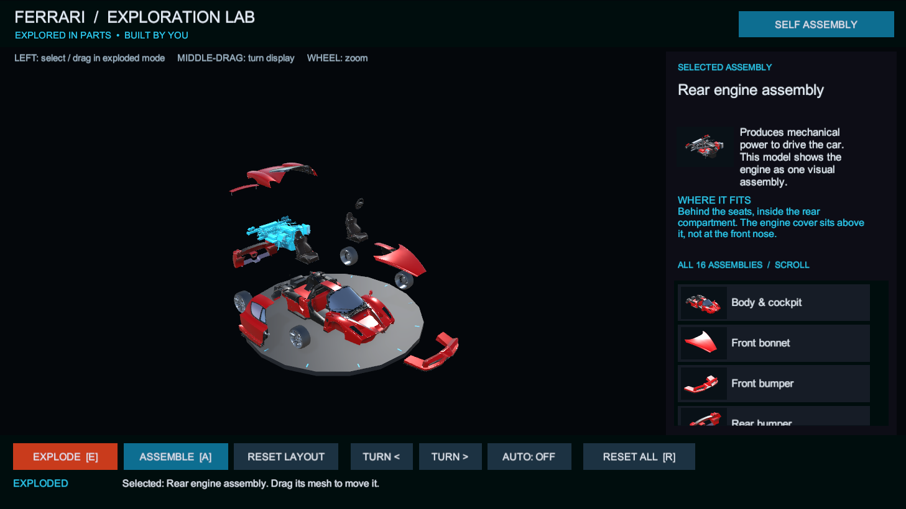
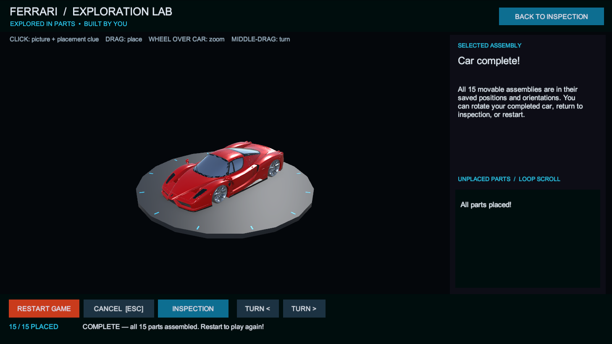

# Ferrari Exploration Lab

A Unity desktop prototype for exploring and assembling a Ferrari Enzo. Inspect 16 named assemblies in an exploded view, then place the 15 movable assemblies by dragging them near their matching positions. Parts snap into place and the game shows assembly progress.

## Screenshots

**Exploded inspection:** select a component to see its purpose and placement clue.

**Completed self assembly:** all 15 movable parts have been placed.

## Open the project

1. Install Unity **6000.4.11f1** and Git LFS.
2. Clone this repository and open the **`My project`** folder in Unity Hub.
3. Open **`Assets/Ferrari/Scenes/FerrariInspection.unity`** and press Play.

In inspection mode, click a part to read about it, drag a part in exploded view, middle-drag to turn the display, and use the mouse wheel over the car to zoom. Select **Self Assembly** to drag parts from the right-hand inventory into the scene. A nearby drop animates the part into its saved position and orientation.

The current interactive prototype uses desktop mouse controls. HTC VIVE Focus 3 support is planned for a later stage.
