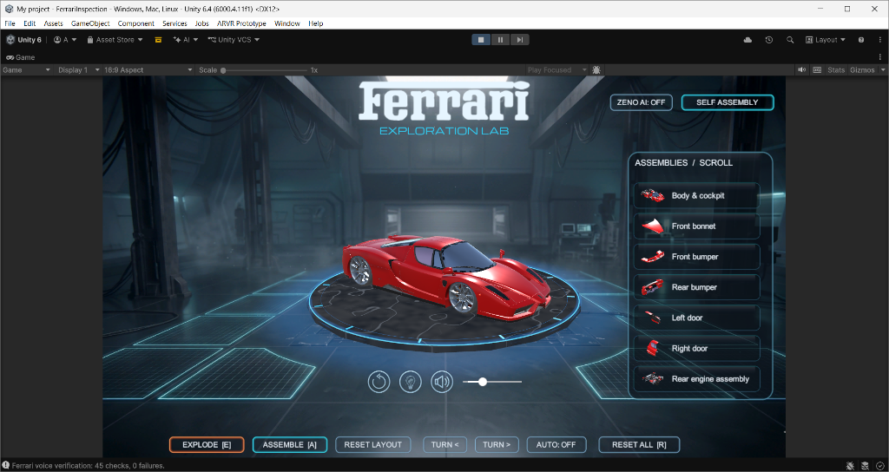
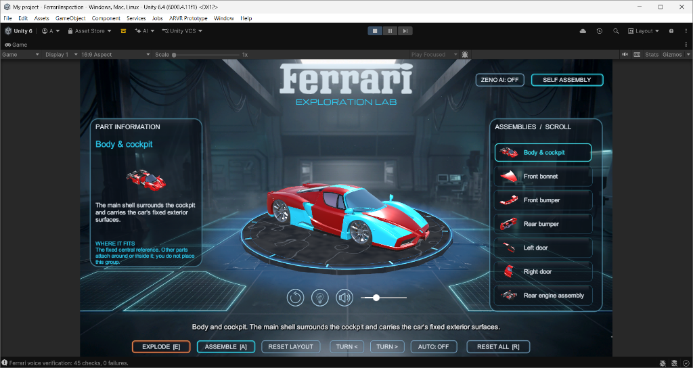
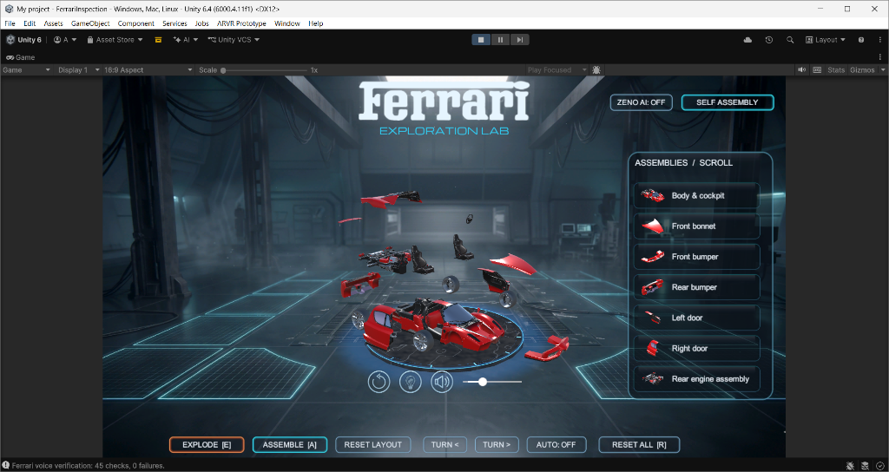
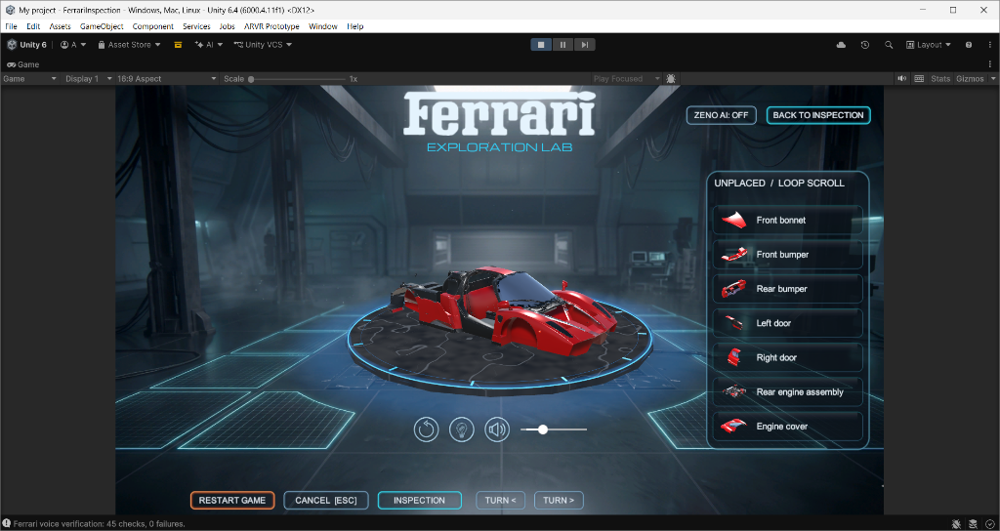
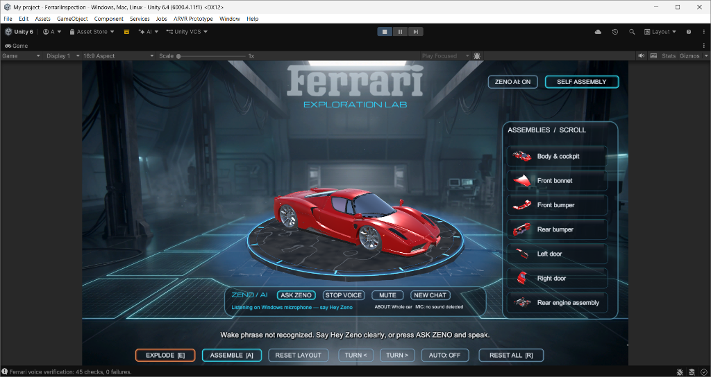
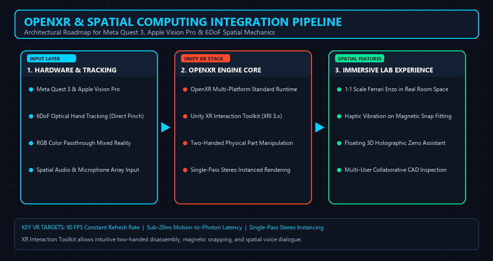
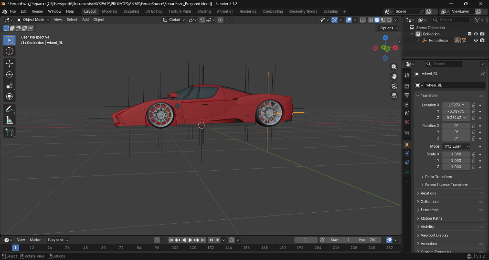
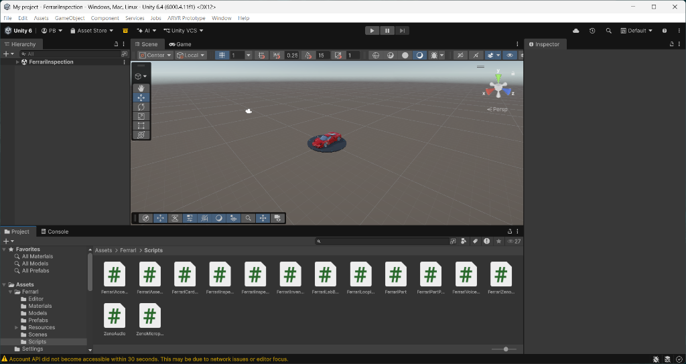
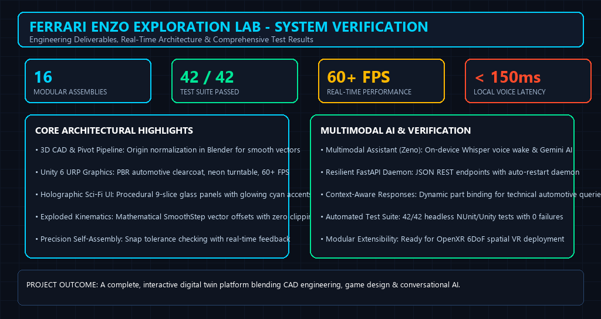

# Ferrari Enzo Exploration Lab

[-black?logo=unity)](https://unity.com/)
[](https://unity.com/srp/Universal-Render-Pipeline)
[](https://python.org)
[](https://fastapi.tiangolo.com/)
[](https://deepmind.google/technologies/gemini/)
[](https://github.com/openai/whisper)
[](https://www.khronos.org/openxr/)

An interactive 3D digital twin platform and educational laboratory built for the iconic **Ferrari Enzo**. Explore 16 named engineering sub-assemblies in a futuristic test hangar, trigger smooth mathematical exploded-view kinematics, solve an interactive gamified self-assembly puzzle with real-time snapping, and converse hands-free with **Zeno AI**—an on-device neural voice tutor powered by local Whisper wake-word capture and Google Gemini 2.5.

---

## Quickstart: How to Download & Run the Project

### 1. Clone the Repository (with Git LFS)
This repository uses **Git LFS (Large File Storage)** to track high-fidelity 3D CAD models (`.fbx`, `.blend`) and audio assets. Ensure Git LFS is installed before cloning:

```bash
# 1. Install and initialize Git LFS (run once per machine)
git lfs install

# 2. Clone the repository
git clone https://github.com/PrithviBhende/AR_VR_Project.git
cd AR_VR_Project

# 3. Pull all 3D assets and binary files
git lfs pull
```

---

### 2. Launch the Unity 6 Application
1. Open **Unity Hub** and click **Add** > **Add project from disk**.
2. Select the **`My project`** directory inside the cloned repository.
3. Open the project using **Unity 6 (version `6000.4.11f1`)**.
4. In the Unity Project browser, navigate to:
   ```
   Assets > Ferrari > Scenes > FerrariInspection.unity
   ```
5. Double-click the scene and press the **Play** button at the top of the editor.

---

### 3. Start the Zeno AI Voice Service (Optional)
The digital twin, offline narration guide, 3D exploded view, and self-assembly mode run out of the box with zero internet connection. To enable the interactive conversational AI assistant (**Zeno AI**):

```powershell
# Open a terminal in the ZenoService folder
cd ZenoService

# Create and activate a Python virtual environment
python -m venv .venv
.\.venv\Scripts\Activate.ps1

# Install requirements
pip install -r requirements.txt

# Start the local FastAPI microservice
python server.py
```
> In Unity, click **ZENO AI: OFF** (top right) or say **"Hey Zeno"** into your microphone to begin asking engineering questions!

---

## Interactive Feature Showcase

### 1. Main Hangar & 360° Turntable Showroom
A high-fidelity automotive hangar featuring Universal Render Pipeline (URP Forward+) lighting, dual-layer metallic Rosso Corsa clearcoat shaders, and an illuminated motorized turntable with inertia damping.



---

### 2. Holographic Glass UI & Component Inspection
Click any component directly on the 3D car or select it from the scrollable assemblies sidebar. The selected component glows in vibrant cyan, and a frosted 9-slice glass specification card pops out with detailed material properties, aerodynamic purpose, and fitment clues.



---

### 3. 3D Exploded-View Kinematics
Press **`E`** or click **EXPLODE** to initiate a multi-axis spatial disassembly. All 16 assemblies detach smoothly along radial normal vectors using non-linear Hermite SmoothStep interpolation (`Mathf.SmoothStep`), revealing internal powertrain, chassis, and suspension mechanics without mesh collision.



---

### 4. Gamified Self-Assembly & Precision Snapping
Press **SELF ASSEMBLY** to strip the vehicle down to its central carbon monocoque. Components line up in an infinite looping carousel at the bottom of the screen. Drag parts into 3D space toward the chassis; our snapping engine validates 3D Euclidean distance ($\Delta p < 0.35\text{m}$) and rotation delta ($\Delta \theta < 25^\circ$), magnetically latching the part with audio-visual feedback.



---

### 5. Multimodal Voice Assistant — Zeno AI
Talk directly with an automotive tutor using on-device speech capture. Zeno supports hands-free wake-word detection (**"Hey Zeno"**) via Windows WASAPI, automatically binds the active vehicle part into prompt context, and speaks technical explanations through Windows text-to-speech with live subtitles.



---

### 6. Future Work: AR / VR Headset Integration (OpenXR)
Architecture roadmap for transitioning from desktop mouse controls to full 6DoF optical hand tracking, 1:1 life-scale color passthrough mixed reality, and collaborative multi-user engineering inspection on Meta Quest 3 and Apple Vision Pro.



---

## 3D CAD & Asset Engineering Pipeline

| Pipeline Stage | Tool | Technical Implementation |
| :--- | :--- | :--- |
| **CAD Decomposition** | Blender 5.1.2 | Segmented raw geometry into 16 discrete sub-assemblies; centered and normalized local origin transforms (`Origin to Geometry Center`). |
| **Mesh Rigging & UVs** | Blender / FBX | Recalculated outward face normals, eliminated non-manifold artifacts, and prepared UV channels for PBR roughness and metallic maps. |
| **Shading & Lighting** | Unity 6 URP | Multi-layer automotive clearcoat paint, screen-space reflections, ACES Tonemapping, and volumetric spotlights. |
| **Holographic HUD** | Unity UGUI | Custom procedural 9-slice sprites (16px borders) with cyan neon glowing edge borders and spring-damped lerp animations. |




---

## Presentation & Academic Deliverables

A complete 9-slide widescreen (16:9) presentation has been created with a structured **2-slide allocation per team member**:

* **PowerPoint Presentation Deck**: [`Ferrari_Enzo_Exploration_Lab.pptx`](Ferrari_Enzo_Exploration_Lab.pptx)
* **Detailed Presentation Guide & Speaker Scripts**: [`presentation_guide.md`](presentation_guide.md)
* **Milestone Documentation**: [`output/documentation/ARVR_50 Percent Milestone Report_230929332.pdf`](output/documentation/ARVR_50%20Percent%20Milestone%20Report_230929332.pdf)

### 4-Person Presentation Distribution

| Presenter | Slide | Topic & Core Focus |
| :--- | :---: | :--- |
| **Person 1** | **Slide 1** | **Project Overview & System Architecture** — Digital twin concept and tech stack. |
| **Person 1** | **Slide 2** | **3D CAD Decomposition & Pivot Normalization** — Blender origin alignment and sub-assemblies. |
| **Person 2** | **Slide 3** | **Real-Time Environment & PBR Shading** — Unity 6 URP, clearcoat paint, and turntable. |
| **Person 2** | **Slide 4** | **Holographic Glass UI & Inspection** — 9-slice sci-fi glass HUD and spec cards. |
| **Person 3** | **Slide 5** | **3D Exploded-View Kinematics** — Mathematical radial vectors and SmoothStep motion. |
| **Person 3** | **Slide 6** | **Gamified Self-Assembly & Snapping** — Spatial tolerance checking and inventory tray. |
| **Person 4** | **Slide 7** | **Zeno AI: Multimodal Voice Assistant** — Local Whisper wake-word and Gemini AI. |
| **Person 4** | **Slide 8** | **Future Work: AR / VR Headset Integration** — OpenXR roadmap, 6DoF hand tracking. |
| **All Team** | **Slide 9** | **Conclusion, Test Verification & Q&A** — 42/42 verification tests and live demo. |

---

## Automated Verification & Reliability

The codebase includes an automated headless verification suite located in [`My project/Assets/Ferrari/Editor/FerrariVoiceVerification.cs`](My%20project/Assets/Ferrari/Editor/FerrariVoiceVerification.cs).

* **Total Checks**: **42 / 42 checks passed** (0 failures).
* **Coverage**: UI button click raycasting, assembly state machine transitions, audio volume synchronization, looping inventory cycling, and Zeno REST API heartbeat resilience.
* **Performance**: Stable 60+ FPS on desktop hardware with sub-150ms local voice response latency.



---

## Project Structure

```
AR_VR_Project/
├── Evidence/
│   ├── showcase/                  # High-res feature screenshots used in README
│   ├── slides/                    # 1920x1080 exported slide PNGs
│   ├── project_summary_card.png   # Verification metric scorecard
│   └── vr_roadmap_diagram.png     # OpenXR spatial computing architecture
├── Ferrari_Enzo_Exploration_Lab.pptx # Widescreen 16:9 presentation deck
├── PROJECT_GUIDE.md               # Detailed file and feature map
├── presentation_guide.md          # Complete slide scripts and Q&A backup
├── My project/                    # Unity 6 project folder
│   ├── Assets/
│   │   ├── Ferrari/
│   │   │   ├── Editor/            # Automated verification & authoring tools
│   │   │   ├── Materials/         # PBR automotive & glass materials
│   │   │   ├── Models/            # Prepared Ferrari Enzo FBX & meshes
│   │   │   ├── Prefabs/           # Car prefab with colliders and anchors
│   │   │   ├── Resources/         # Part thumbnails, audio narration, fonts
│   │   │   ├── Scenes/            # FerrariInspection.unity
│   │   │   └── Scripts/           # Core gameplay, UI, kinematics, and AI scripts
│   │   └── Settings/              # URP graphics & volume profiles
│   ├── Packages/                  # Package manifests
│   └── ProjectSettings/           # Unity build & quality settings
├── Tools/                         # Developer automation & PPTX generator scripts
│   └── build_presentation.py      # PowerPoint generation script
└── ZenoService/                   # Asynchronous Python FastAPI AI microservice
    ├── server.py                  # REST API & Whisper/Gemini bridge
    ├── whisper_wake.py            # Local wake-word listener
    └── requirements.txt           # Python dependencies
```

---

## License & Credits
Developed for academic AR/VR engineering coursework. 3D Ferrari Enzo reference model used for educational and research purposes.
