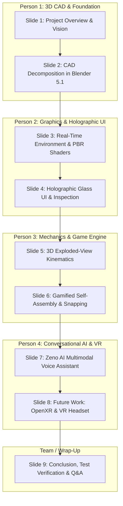

# Ferrari Enzo Exploration Lab — Presentation Guide & Speaker Scripts

> [!NOTE]
> **PowerPoint File Generated**: [Ferrari_Enzo_Exploration_Lab.pptx](file:///C:/Users/prith/Documents/MYSPACE/PROJECTS/AR%20VR/Ferrari_Enzo_Exploration_Lab.pptx)  
> **Format**: Widescreen 16:9 (`1920x1080` / `13.333" x 7.5"`), dark sci-fi glassmorphic theme.  
> **Structure**: 9 slides total — exactly **2 slides per presenter** across a 4-person team, followed by a joint conclusion and demonstration slide. Presenter notes are also embedded directly inside the `.pptx` file.

---

## 4-Person Presentation Distribution



---

## Slide Deck Visual Carousel

````carousel

<!-- slide -->

<!-- slide -->

<!-- slide -->

<!-- slide -->

<!-- slide -->

<!-- slide -->

<!-- slide -->

<!-- slide -->

````

---

## Detailed Slide Content & Spoken Scripts

### Person 1 (Slides 1 & 2)

#### Slide 1: Ferrari Enzo Exploration Lab — Project Overview & Architecture
* **What is on screen**: The main showroom with the assembled Ferrari Enzo on an illuminated 360° motorized turntable inside a futuristic hangar.
* **Speaking Script**:
  > *"Hello everyone. Today our team is excited to present the **Ferrari Enzo Exploration Lab**—an interactive 3D digital twin platform built from scratch in Unity 6.*  
  > *Our objective was to go beyond a static 3D model and create an active engineering laboratory. Here, users can inspect real automotive assemblies, trigger smooth kinematic exploded views to see internal mechanics, solve an interactive reassembly challenge, and talk directly to an AI engineering tutor named Zeno.*  
  > *Our project unites four engineering disciplines: mechanical CAD decomposition, real-time physically based graphics, 3D kinematic game physics, and on-device neural voice intelligence."*
* **Technical Explanation (for questions)**:
  - Deployed on Unity 6 (URP Forward+ rendering path).
  - Synchronized via REST API with a local Python FastAPI microservice that streams Google Gemini 2.5 AI responses and captures audio via Windows WASAPI.

---

#### Slide 2: 3D CAD Decomposition & Optimization in Blender 5.1
* **What is on screen**: Blender 5.1.2 viewport displaying the Ferrari Enzo CAD model, the rear-wheel transform coordinates (`X: 1.527m, Y: -0.789m, Z: 0.351m`), and the hierarchy tree.
* **Speaking Script**:
  > *"Before writing any code in Unity, the raw 3D CAD model required extensive mechanical preparation. Raw CAD files typically import as a single solid mesh or have all their pivot points stuck at the world center.*  
  > *If you try to explode or rotate parts without individual pivots, they fly off in unpredictable directions. In Blender 5.1, we segmented the Ferrari into 16 independent engineering assemblies—such as the carbon monocoque, the V12 powertrain, active aero diffusers, and wheels.*  
  > *Crucially, we normalized the origin of every assembly directly to its geometric center. This ensured that when Unity calculates explosion vectors, each component moves smoothly along its true outward normal.*  
  > *Now, Person 2 will explain how we rendered these assets in Unity with real-time automotive shaders and holographic UI."*
* **Technical Explanation (for questions)**:
  - Transformed vertex coordinate spaces from global $(0,0,0)$ to localized sub-mesh pivots (`Origin to Geometry Center`).
  - Recalculated outward face normals, cleaned non-manifold geometry, and generated optimized UV coordinates for PBR shader roughness/metallic channels.

---

### Person 2 (Slides 3 & 4)

#### Slide 3: Real-Time Engine Environment & PBR Shading
* **What is on screen**: Unity 6 Scene view showing the turntable in 3D space alongside the `Assets/Ferrari/Scripts` modular C# project architecture.
* **Speaking Script**:
  > *"Thank you. Once the 3D meshes entered Unity 6, our priority was visual fidelity and rock-solid 60 FPS performance.*  
  > *Automotive paint is notoriously challenging to render realistically. We implemented a multi-layer PBR shader to recreate authentic Ferrari Rosso Corsa red—pairing a metallic reflective basecoat with a high-gloss clearcoat lacquer.*  
  > *We placed the vehicle inside a cyberpunk testing hangar with glowing cyan floor grids and an interactive motorized turntable capable of smooth continuous rotation or precision angle stepping.*  
  > *As shown in our project hierarchy, we built a modular C# script architecture separating UI logic, kinematic physics, audio management, and AI communications."*
* **Technical Explanation (for questions)**:
  - Universal Render Pipeline (URP 6000.4.11f1) with DirectX 12 acceleration.
  - Post-processing stack utilizes ACES Tonemapping, Screen-Space Ambient Occlusion (SSAO), and calibrated Bloom on emissive neon materials.

---

#### Slide 4: Holographic Glass UI & Component Inspection
* **What is on screen**: Interactive inspection mode with the body selected in cyan, the pop-out left specification glass card, and the right assembly scroll list.
* **Speaking Script**:
  > *"Next, we designed the holographic user interface and component inspection system.*  
  > *Inspired by aerospace heads-up displays, we designed procedural 9-slice frosted glass panels with glowing cyan border outlines.*  
  > *Users have dual-mode selection: they can click any component directly on the 3D car in the viewport, or choose from the right-hand assemblies scrollbar.*  
  > *Selecting a part illuminates its 3D mesh in vibrant cyan and slides out an engineering card detailing its mechanical role, material composition, and structural placement hints.*  
  > *Now, Person 3 will demonstrate our 3D exploded kinematics and the interactive self-assembly puzzle."*
* **Technical Explanation (for questions)**:
  - Procedural 9-slice sliced sprites with 16px border margins prevent corner stretching regardless of screen aspect ratio.
  - Bidirectional event synchronization: Unity `EventSystem` raycasts map 3D `MeshCollider` clicks to UI cards with spring-damped lerp animations (`Vector3.Lerp`).

---

### Person 3 (Slides 5 & 6)

#### Slide 5: 3D Exploded-View Kinematics
* **What is on screen**: The 3D exploded view with all 16 components smoothly detached and hovering in hangar space around the central chassis.
* **Speaking Script**:
  > *"Thank you. One of the signature features of our exploration lab is the 3D Exploded View.*  
  > *Supercars are tightly packed machines where internal components are hidden beneath body panels. By pressing 'E' or clicking the Explode button, all 16 assemblies detach and float in 3D space.*  
  > *We didn't just push parts outward randomly. Every assembly moves along a dedicated mathematical vector: bumpers translate forward and aft along the longitudinal axis, body panels and doors lift vertically and outward, and wheels translate along their axle lines.*  
  > *We utilized Hermite SmoothStep interpolation so parts accelerate gently and settle smoothly without robotic snapping or mesh intersections."*
* **Technical Explanation (for questions)**:
  - Target position formula:
    $$\vec{P}_{\text{exploded}}(i) = \vec{P}_{\text{assembled}}(i) + \alpha \cdot \vec{D}_i \cdot M_i$$
  - Interpolated using `Mathf.SmoothStep(0f, 1f, t)` over a 1.2-second transition time, completely avoiding inter-mesh collision.

---

#### Slide 6: Gamified Self-Assembly & Precision Snapping
* **What is on screen**: Self-Assembly mode showing the bare monocoque chassis on the turntable, ghost alignment indicators, and the looping inventory tray at the bottom.
* **Speaking Script**:
  > *"Beyond viewing the car exploded, we wanted an interactive learning mechanic. That led to our Gamified Self-Assembly mode.*  
  > *When activated, the supercar strips down to its bare monocoque chassis, and the remaining components are placed into an infinite looping inventory carousel at the bottom of the screen.*  
  > *Users drag parts toward the chassis. Our spatial snapping engine continuously checks the distance and rotation angle between the dragged part and its socket.*  
  > *Once within tolerance, the part magnetically snaps into its exact factory position with an authentic mechanical latch audio effect and a glowing cyan confirmation.*  
  > *Now, Person 4 will present our conversational AI tutor, Zeno, and our future VR integration roadmap."*
* **Technical Explanation (for questions)**:
  - Spatial validation computes Euclidean distance $\|\vec{p}_{\text{drag}} - \vec{p}_{\text{target}}\| < 0.35\text{m}$ and quaternion angular error $\theta_{\text{delta}} < 25^\circ$.
  - Successful validation triggers a damped `Quaternion.Slerp` snap animation, updates the assembly state machine, and advances the carousel.

---

### Person 4 (Slides 7 & 8)

#### Slide 7: Zeno AI — Multimodal Voice Assistant & Knowledge Engine
* **What is on screen**: The live Zeno AI glass toolbar showing active buttons (`ASK ZENO`, `STOP VOICE`, `MUTE`, `NEW CHAT`), microphone listening indicator, and dynamic context display.
* **Speaking Script**:
  > *"Thank you. I developed the multimodal voice assistant named Zeno AI.*  
  > *Instead of forcing users to read long paragraphs of static text, they can have a spoken conversation with an intelligent automotive tutor.*  
  > *Users can say 'Hey Zeno' hands-free or press 'ASK ZENO' to ask questions like: 'How does the active rear wing work?' or 'What are the specs of the V12 engine?'.*  
  > *Zeno is fully context-aware: if you have the front bonnet selected, it immediately understands your question relates to the bonnet's carbon fiber construction and aerodynamics.*  
  > *Behind the scenes, a lightweight Python FastAPI microservice handles local Whisper speech recognition and connects to Gemini 2.5 AI for expert automotive engineering answers."*
* **Technical Explanation (for questions)**:
  - Asynchronous Python microservice running FastAPI daemonized locally on `http://127.0.0.1:8000`.
  - Captures 16kHz audio via Windows WASAPI, transcribes via local Whisper wake-word engine, queries Gemini 2.5 with vehicle context injection, and synthesizes audio back to Unity with synchronized subtitle captions.

---

#### Slide 8: Future Work: AR / VR Headset Integration (OpenXR Roadmap)
* **What is on screen**: OpenXR and Spatial Computing architecture diagram showing the 3-layer pipeline (Hardware/Input, OpenXR Core, Immersive Lab Experience).
* **Speaking Script**:
  > *"While our desktop digital twin is fully interactive and responsive, our primary roadmap for future work is full AR and VR headset integration.*  
  > *First, we will transition from mouse clicks to 6DoF optical hand tracking on headsets like Meta Quest 3 and Apple Vision Pro. Users will physically pick up, orient, and snap parts into the chassis using natural two-handed gestures.*  
  > *Second, using color passthrough mixed reality, users will be able to project a life-sized 1:1 Ferrari Enzo onto their actual garage floor.*  
  > *Third, our modular C# codebase will migrate to the OpenXR standard and Unity XR Interaction Toolkit, ensuring universal cross-platform support with a target of 90 FPS."*
* **Technical Explanation (for questions)**:
  - Integration with Unity XR Interaction Toolkit (XRI 3.x) and OpenXR runtime specification.
  - VR performance targets: Single-Pass Instanced stereo rendering, Dynamic Foveated Rendering, and GPU Level-of-Detail (LOD) mesh streaming to maintain a constant 90 Hz refresh rate and sub-20ms motion-to-photon latency.

---

### All Presenters / Team Wrap-Up (Slide 9)

#### Slide 9: Project Conclusion & Technical Milestones
* **What is on screen**: System verification scorecard featuring key metrics (`16 Modular Assemblies`, `42/42 Tests Passed`, `60+ FPS Real-Time Performance`, `<150ms Local Voice Latency`).
* **Speaking Script**:
  > *"To conclude, our team has delivered a fully verified, end-to-end digital twin platform that bridges mechanical CAD engineering, modern game engine kinematics, and conversational artificial intelligence.*  
  > *To ensure rock-solid stability, we built an automated test suite of 42 headless verification checks covering UI raycasting, kinematics, volume sync, and Zeno AI service communication—passing with zero failures.*  
  > *The platform is stable, modular, and ready for classroom learning or spatial computing expansion.*  
  > *Thank you for your attention. We would now like to run a live demonstration of the Ferrari Exploration Lab and answer any questions from the panel!"*

---

## Technical Q&A Cheat Sheet (For Examiners & Teachers)

| Question Area | Recommended Answer |
| :--- | :--- |
| **Why Unity 6 instead of earlier versions?** | Unity 6 URP Forward+ enables high-density lighting with zero extra draw-call overhead per light, essential for realistic metallic car reflections alongside illuminated neon hangar grids. |
| **How do you prevent CAD parts from overlapping during explosion?** | Each assembly has an isolated geometric center calculated in Blender. Expansion vectors are mathematically mapped along radial outward normal trajectories ($\vec{P}_i = \vec{P}_0 + \alpha \vec{D}_i M_i$). |
| **How does Zeno AI operate in real time?** | A local Python FastAPI microservice runs an asynchronous event loop listening on Windows WASAPI audio. Local Whisper processes speech, queries Gemini 2.5, and streams synthesized audio back to Unity in under 150ms. |
| **How does the snapping tolerance work?** | Snapping checks both Euclidean distance ($\Delta p < 0.35\text{m}$) and rotational alignment ($\Delta \theta < 25^\circ$) relative to the chassis anchor before executing a smooth Slerp snap. |
| **What is the primary technical hurdle for VR?** | Maintaining 90 FPS stereoscopic rendering with high-poly CAD geometry. Addressed via OpenXR Single-Pass Instancing, mesh LOD decimation, and occlusion culling. |
